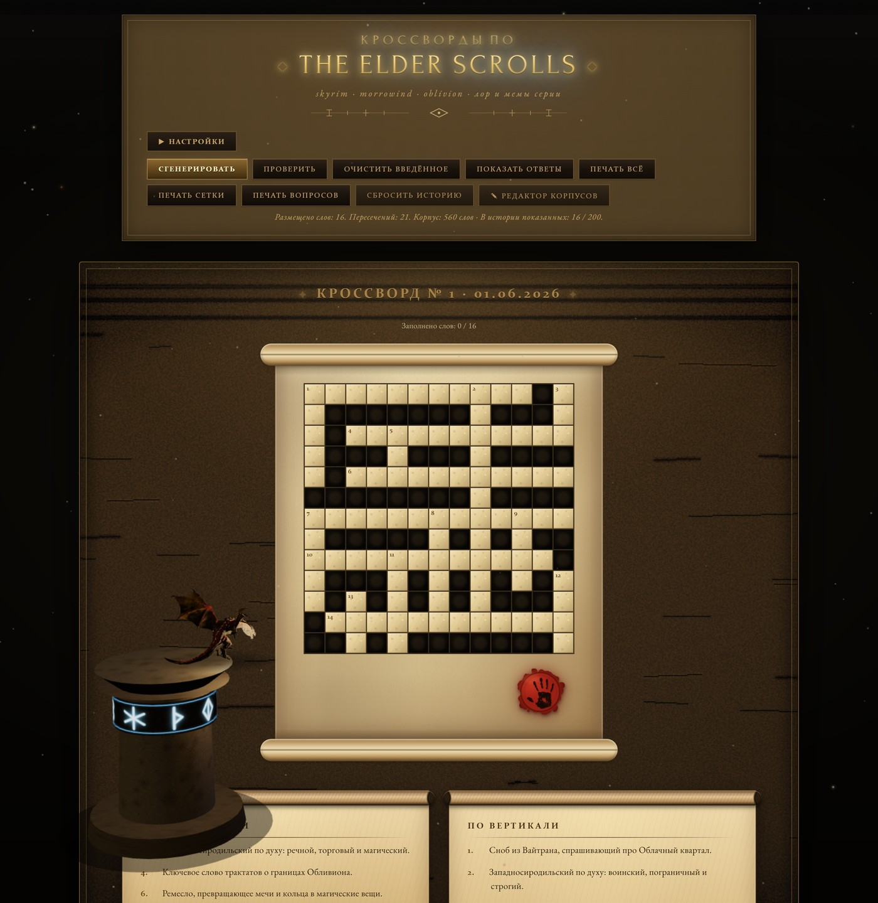
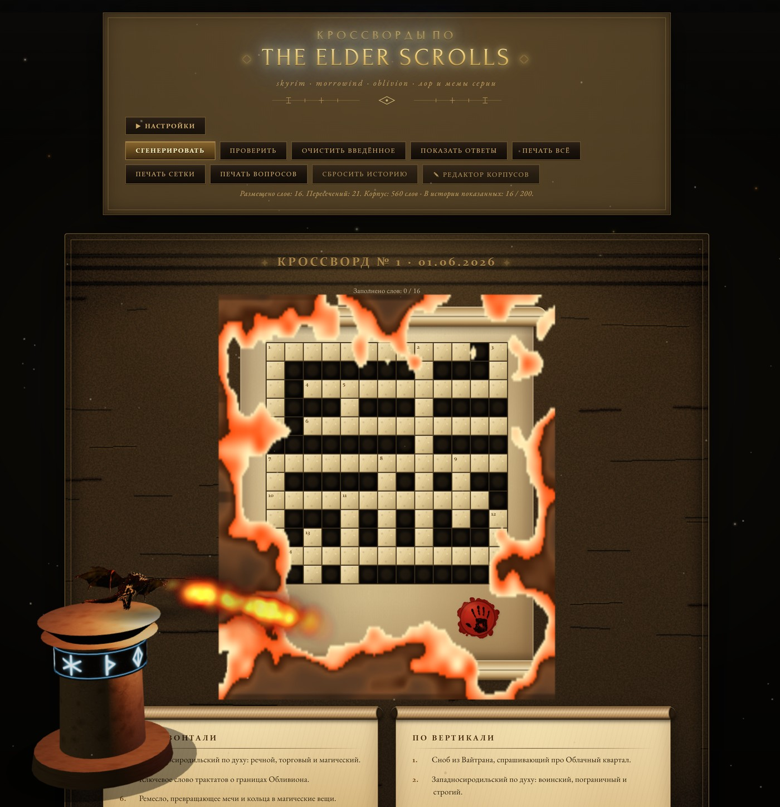

# Кроссворды по The Elder Scrolls

Кроссворды по миру TES: Skyrim, Morrowind, Oblivion, общий лор и мемы серии. **1000 слов**, прямые и хитрые вопросы, сетки от 11×11 до 25×25. Можно разгадывать в браузере или распечатать. А перед новой сеткой 3D-дракон сжигает старый свиток.

🎮 **Играть онлайн** (с 3D-сценой): https://andromanpro.github.io/printable-crosswords-tes/



> **Кинематографический режим.** Кроссворд лежит на состаренном свитке; над каменным постаментом парит дракон со светящимся руническим поясом. Жмёшь печать Тёмного Братства (или «Сгенерировать») — дракон выдыхает пламя, свиток прогорает по огненной кромке и разворачивается новый кроссворд:



*(Обычный режим — без 3D — это чистый печатный кроссворд: открывается двойным кликом, работает офлайн.)*

## Запуск

Самый быстрый способ — [открыть готовую версию](https://andromanpro.github.io/printable-crosswords-tes/).

Для локального запуска обычного кроссворда можно открыть `index.html` **двойным кликом**, без сервера и интернета.

Для режима **«3D-сцена / Кинематографичный»** нужен локальный сервер: браузеры (особенно Chrome/Edge) ограничивают загрузку ES-модулей и GLB/glTF через `file:///`, поэтому при простом двойном клике 3D-дракон может не загрузиться — обычный кроссворд при этом работает. Проще всего — батник:

```bash
serve.bat
```

Он поднимает `http.server` на `http://127.0.0.1:8767`. Эквивалент вручную:

```bash
py -3.14 -m http.server 8767 --bind 127.0.0.1
```

Потом открыть `http://127.0.0.1:8767/index.html`. Основная модель дракона уже входит в репозиторий. Дополнительные модели можно положить в `assets/models/`; ожидаемые имена — в [описании моделей](assets/models/README.md).

## Использование

1. Жми **«Сгенерировать»** — получаешь новый кроссворд (13×13 по умолчанию).
2. Решаешь прямо в браузере (клик в клетку, набирать с клавиатуры) или печатаешь — **`Ctrl+P`** → «Сохранить как PDF».
3. Кнопка **«Показать ответы»** — для проверки.
4. **«Печать сетки»** — только клетки, без вопросов (если хочешь решить ручкой и не подсматривать).

### Два стиля подсказок

- **«Прямые (фактические)»** — обычные определения, фактическое описание слова.
- **«Хитрые (с намёком)»** — **у каждого из 1000 слов есть минимум 2 хитрые формулировки** (мемы, цитаты, образные описания), а у **100 слов** — по 6. При размещении слова выбирается случайная формулировка; при повторной встрече она может оказаться другой. Примеры:
  - **НАЗЕЕМ** → «Единственный норд, которого убивают даже в самом законопослушном прохождении.»
  - **ФУСРОДА** → «Три слога, после которых мебель и враги летят одинаково.»
  - **ЛИДИЯ** → «Верный хускарл, готовая умереть от твоего же файрбола в спину.»
  - **АЛДУИН** → «Тот, чей крик «Зу мии лон» обещает конец времён.»

## ✦ Кинематографический режим (Nordic Tomes)

В режиме **«Кинематографичный»** страница превращается в сцену в духе древнего зала. Модель Ancient Dragon из TES Blades уже включена в репозиторий:

- **Свиток-пергамент.** Кроссворд лежит на свитке со скрученными сверху и снизу валиками, печатью Тёмного Братства и состаренной бумагой (волокна, разводы-foxing).
- **Дракон над постаментом.** Анимированный дракон парит над каменным постаментом со светящимся руническим поясом — дышит, водит головой; свет, размер и положение настраиваются.
- **Сжигание свитка.** Жмёшь печать Тёмного Братства (или «Сгенерировать») — дракон выдыхает пламя, старый свиток прогорает по неровной огненной кромке (под золой проступает доска), летят угли, искры и пепел, поднимается дым, а затем разворачивается новый свиток с новым кроссвордом.
- **Светящиеся руны.** Наводишь на пустую клетку — проступает руна Старшего Футарка (шрифт Noto Sans Runic); наводишь на номер в сетке — разворачивается стилизованный свиток с вопросом.
- **Атмосфера.** Свечной свет по краям сцены, виньетка и аутентичные шрифты (Forum в заголовке с рунным свечением, EB Garamond в тексте) — всё локально, без интернета.

Тонкая настройка дракона (положение, размер, огонь, свет, постамент) — на странице `dragon-lab.html`; подобранные значения «запекаются» в дефолты основной страницы.

> Основная модель — **The Elder Scrolls Blades Ancient Dragon** от **OrangeSauceu**, CC BY 4.0. Авторство, источник и изменения указаны в [атрибуции](assets/models/ATTRIBUTION.md). Дополнительные модели не включены. Если файл модели недоступен, сцена показывает процедурную заглушку.

## Что внутри

Два тематических пака — **1000 уникальных слов** суммарно:

### `pack-skyrim-core` — 556 записей
Узнаваемый Skyrim (TES V):
- Города и локации (Вайтран, Маркарт, Виндхельм, Солитьюд, Совнгард, Хротгар…)
- Кричи и Тху'умы (Фус, Ро, Да, Йол, Тоор, Шул…)
- Драконы (Алдуин, Партурнакс, Одавинг, Мирак…)
- NPC (Балгруф, Делфин, Эсберн, Серана, Лидия, Мерсер, Ульфрик…)
- Фракции (Соратники, Седобородые, Клинки, Тёмное Братство, Коллегия, Талмор, Волкихар…)
- Артефакты (Драконобой, Рассветник, Волендрунг, Намира, Сангвин, Азура, Огма…)
- Расы (Норд, Каджит, Аргонианин, Альтмер, Босмер, Данмер…)
- Существа (Драугр, Хагравен, Спригган, Фалмер, Хоркер…)
- Магия и Девять Богов
- Мемы серии: Колено (стрела стражника), Рулет / Сладкий Рулет, Фусрода, Назеем, Лидия, Майк, Курица, Хадвар, Ралоф, Цицерон, Скуума, Ведро, Моды, Баги, Капуста, Дева, Курио…

### `pack-tes-deep-lore` — 444 записи
Лор серии вне Skyrim:
- Принцы Даэдра (Молаг Бал, Меридия, Боэта, Малакат, Мефала, Мерунес Дагон, Хермеус Мора, Ноктюрнал, Хирсин, Вермина, Шеогорат, Клавикус…)
- Morrowind: Великие Дома (Хлаалу, Редоран, Телванни, Индорил, Дрес), Дагот Ур, Вивек, Альмалексия, Сота Сил, Неревар, Кагренак, локации (Балмора, Альд-Рун, Сейда-Нин, Кальдера, Вварденфелл, Морнхолд), существа (гуар, кагути, квама, скриб, алит)
- Oblivion: города Сиродила (Кватч, Брума, Анвил, Скинград, Чейдинхол, Лейавиин, Бравиль), сюжет (Мартин, Уриэль, Манкар Каморан, Баурус), артефакты (Сигил, Велкинд, Варла, Умбра)
- Древние расы (Айлейды, Велотиане, Тсаесци, Акавирцы, Камальцы)
- Лор-понятия (Лорхан, Шезарр, Аурбис, Драконолом, Тональность, Адамантин)
- История (Тайбер Септим, Алессианский, Пелинал, Морихаус, Потентат)
- Книги (Мономиф, Ануад, Арктурианская…)

### Хитрые формулировки

**У каждого из 1000 слов есть минимум 2 хитрые формулировки**, а у **100 слов** — по 6. При размещении слова выбирается случайная формулировка. Например:
- ЦИЦЕРОН → «Танцующий безумец, чью фразу про "масло" помнят все.»
- ХАДВАР → «Первый друг в Хелгене, чей дядя работает кузнецом в Ривервуде.»
- РАЛОФ → «Брат Бури, чья сестра держит таверну в Ривервуде.»
- КУРИЦА → «Пернатый детектор зла, превращающий всю деревню в линчевателей.»
- МАЙК → «Пушистый торговец, чьи мудрые изречения цитируют чаще, чем Нельсона Манделу.»

## Технические подробности

- **Стек**: vanilla HTML+JS+CSS, без бандлеров, без интернета. Шрифты (Forum, PT Serif, EB Garamond, Noto Sans Runic) — локальные woff2.
- **3D-дракон**: локальный Three.js + GLTFLoader; без модели показывает процедурный fallback, с GLB/glTF подхватывает настоящий меш. Огонь из пасти привязан к кости головы.
- **Эффекты сжигания**: огненная кромка и зольная доска рисуются на canvas по единой карте прожига; угли/искры/пепел/дым — отдельный canvas-движок частиц, засыпающий когда частиц нет.
- **Кроссворды**: классические, размеры 11×11 / 13×13 / 15×15 / 21×21 / 25×25.
- **Темы оформления**: светлая и тёмная.
- **Печать**: формат A4, сетка с вопросами или отдельная печать сетки / вопросов; ответы можно скрыть.
- **История**: в localStorage хранятся последние показанные слова — по умолчанию 200. Глубина настраивается от 20 до 5000; генератор учитывает историю при подборе следующей сетки. Это история слов, а не архив кроссвордов.
- **Свой пак**: «✎ Редактор корпусов» — можешь редактировать или добавить свои слова. Готовый `.js` загружается через «+ Загрузить свой пак».

## Размер словарного запаса для пересечений

В наборах есть короткие слова для пересечений и длинные названия для крупных сеток. Количество слов в конкретном кроссворде зависит от размера, выбранных наборов, сложности и результата генерации.

## Известные ограничения печати

- «Уместить всё на 1 лист A4» пока не гарантирует один лист: в проверенном примере 13×13 сетка и вопросы вышли на двух страницах.
- При печати только вопросов может добавляться пустая последняя страница.
- Наложение декоративной рамки на заголовок исправлено: экранная рамка теперь отключается при печати.

## Лицензия

Код — [MIT](LICENSE). Для сторонних моделей действуют их лицензии; основная модель дракона — CC BY 4.0, см. [атрибуцию](assets/models/ATTRIBUTION.md).

## Автор

Сделал **[Androman](https://androman.pro)** — инженер с 17-летним стажем; увлекаюсь вебом, 3D-графикой и вселенной The Elder Scrolls.

🌐 [androman.pro](https://androman.pro) · ✈ [Telegram](https://t.me/andromanpro1c) · [GitHub @andromanpro](https://github.com/andromanpro)
